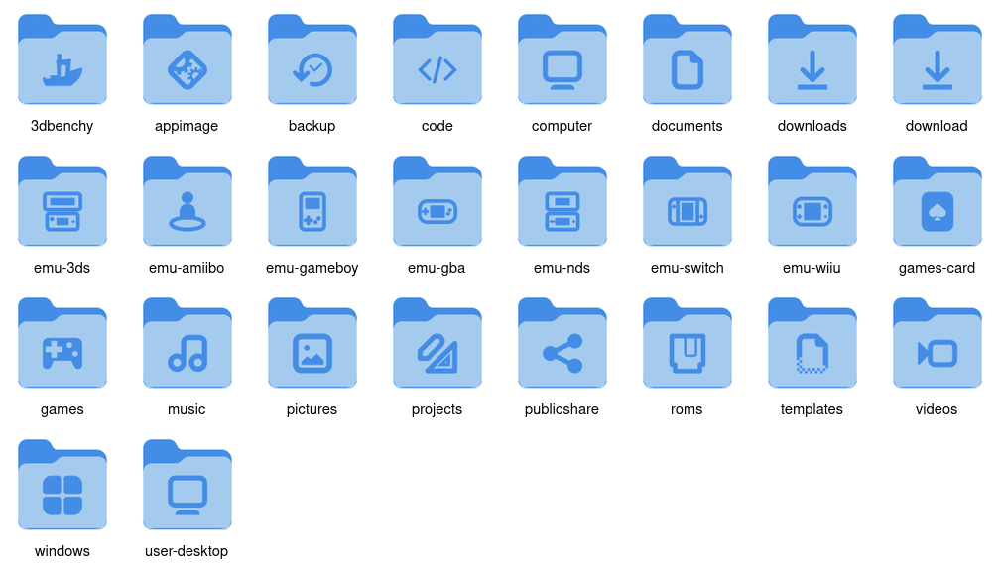

# MoreWaita-Folders

Distinct folder icons for GNOME Files (Nautilus) in the Adwaita/[MoreWaita](https://github.com/somepaulo/MoreWaita) style.



GNOME's Adwaita theme ships icons for Music, Videos, Pictures and the other standard folders only at 16px. In Files' grid view, every folder therefore looks the same. This small add-on theme fixes that and adds a few more:

- **Large icons for the standard XDG folders:** Desktop, Documents, Downloads, Music, Pictures, Videos, Templates and Public. These are made from Adwaita's own glyphs and apply automatically, with no per-folder setup.
- **Console folders** for emulator libraries: Game Boy, GBA, DS, 3DS, Switch, Wii U and Amiibo. They're simple line drawings of the devices, not logos.
- **Size-matched MoreWaita icons.** MoreWaita draws its emblems smaller than Adwaita's glyphs. The build measures every emblem and scales it, so all folders have the same visual weight.
- **A different AppImage icon:** a program icon instead of MoreWaita's arrow and gear.

The theme inherits MoreWaita, then Adwaita, so everything else looks as before.

## Install

You need `git`, `python3`, ImageMagick 7 (`magick`, with SVG support via librsvg) and `gtk-update-icon-cache`. Fedora, Bazzite and Silverblue usually have all of these.

```sh
git clone https://github.com/inxomnyaa/morewaita-folders.git
cd morewaita-folders
./install.sh
```

`install.sh` does the following:

1. It downloads MoreWaita into `.cache/MoreWaita`.
2. It builds the theme into `build/`.
3. It installs both MoreWaita and MoreWaita-Folders to `~/.local/share/icons/`. Nothing system-wide is touched, and no root is needed.
4. It sets `MoreWaita-Folders` as your icon theme. Pass `--no-activate` to skip this step, or `--ref <tag|commit>` to pin a MoreWaita version.

## Give your own folders icons

The standard folders are automatic. For any other folder, copy `folders.conf` to `folders.local.conf` (gitignored) and list the folder there, with the icon name first, then the path. Paths are relative to your home folder unless they start with `/`:

```
folder-games            Games
folder-emu-switch       ROMs/Switch
folder-code             src/my-app
```

Then run:

```sh
./apply-folder-icons.sh --dry-run    # shows what it would do
./apply-folder-icons.sh              # applies it
./apply-folder-icons.sh --reset      # removes the custom icons again
```

This sets the folder's `metadata::custom-icon-name`, which is the same thing Files' *Properties → icon* sets. The folder's contents are not changed. If Files doesn't update, run `nautilus -q` and reopen it.

The script uses `folders.local.conf` if it exists, otherwise the example `folders.conf`. You can use any icon name from MoreWaita or Adwaita, not just the ones built here. MoreWaita's are listed in `~/.local/share/icons/MoreWaita/scalable/places/`.

## Icons in this theme

| Icon name | Emblem |
|---|---|
| `folder-music`, `folder-videos`, `folder-pictures`, `folder-documents`, `folder-download(s)`, `folder-templates`, `folder-publicshare` | Adwaita's glyph for that folder |
| `user-desktop` | monitor |
| `folder-appimage` | Adwaita's "executable" glyph |
| `folder-emu-gameboy`, `-gba`, `-nds`, `-3ds`, `-switch`, `-wiiu`, `-amiibo` | own drawings in `glyphs/` |
| `folder-projects`, `folder-games`, `folder-backup`, `folder-3dbenchy`, `folder-code`, `folder-games-card`, `folder-roms`, `folder-computer`, `folder-windows` | MoreWaita's emblem, re-scaled |

## Adding or changing icons

Everything is driven by the `ICONS` table in [`build.py`](build.py). Each entry maps an icon name to an emblem source:

| Source | Meaning |
|---|---|
| `adw:<name>` | Adwaita's `<name>-symbolic.svg`. Browse them in `/usr/share/icons/Adwaita/symbolic/`, or with the *Icon Library* app. |
| `own:<name>` | `glyphs/<name>.svg`: a 16×16 SVG drawn with `currentColor`. Use any style, but outlines with a stroke width of 1.5 match best. |
| `mw:<name>` | The emblem of MoreWaita's `<name>` folder icon. |

Then run `./install.sh` again. To check the result before installing, run `python3 build.py && ./preview.sh`. This writes `build/preview.png`, which shows every icon at once.

## Uninstall

```sh
gsettings set org.gnome.desktop.interface icon-theme Adwaita
./apply-folder-icons.sh --reset
rm -rf ~/.local/share/icons/MoreWaita-Folders ~/.local/share/icons/MoreWaita
```

## License

GPL-3.0, same as MoreWaita. The generated icons combine MoreWaita's folder shape and emblems (GPL-3.0, © MoreWaita contributors) with Adwaita symbolic glyphs (CC-BY-SA 3.0 / LGPL-3.0, © GNOME Project). Neither is stored in this repo; they're fetched or read at build time. The console glyphs in `glyphs/` are original work.
